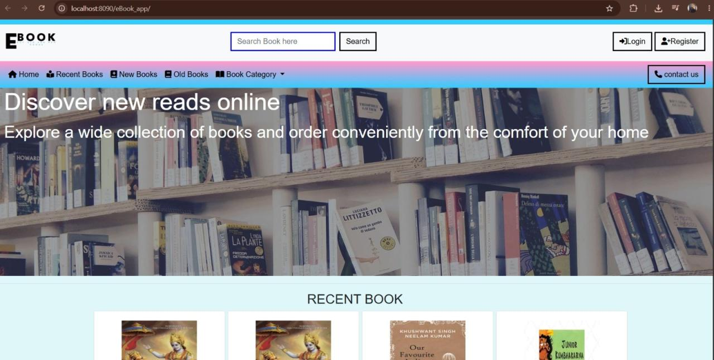

# eBook Management System: Online Book Store

A Java Servlet and JSP web application for browsing, buying and managing e-books, with separate user and administrator areas. Built with Java, Maven and MySQL, then packaged with an embedded H2 database and Docker for an online demo.

> This is a **showcase repository**. The source code lives in a private repository. This page documents what the project does and how it is built. Happy to walk through the code on request.
>
> Student portfolio project, not a production e-commerce system.

[LinkedIn](https://linkedin.com/in/ratnesh-pathak-087466279) | [Email](mailto:pathakratnesh03@gmail.com)

## Preview



## Live Demo

**[Open the live demo](https://ebook-management-system-demo.onrender.com/)**

- It runs on Render's free tier, so the first load can take about a minute while the service wakes up.
- The demo uses an in-memory H2 database, so any changes you make reset when the service restarts.
- Demo accounts for trying it out (not real accounts):
  - Admin: `admin@ebook-demo.com` / `admin123`
  - User: `demo@ebook-demo.com` / `demo123`

## What Is Implemented

| Area | Status |
| --- | --- |
| Home page, book catalogue, recent, new and old books | Implemented |
| Category pages, search and book details | Implemented |
| User registration and login | Implemented |
| Cart and checkout flow | Implemented |
| Orders page | Implemented |
| Admin login and dashboard | Implemented |
| Admin add, edit and delete books | Implemented |
| Real payments (Razorpay) | Not in the online demo; the demo takes cash-on-delivery style orders only |
| Email and SMS notifications | Not enabled in the demo |

## Tech Stack

- **Backend:** Java Servlets
- **Frontend:** JSP, HTML5, CSS3, JavaScript
- **Build:** Maven (WAR) on Apache Tomcat
- **Databases:** MySQL in the original project, embedded H2 for the online demo
- **Deployment:** Docker and Render

## Architecture

```text
Original:  Servlets + JSP -> DAO layer -> MySQL
Demo:      Servlets + JSP -> DAO layer -> embedded H2 -> Docker + Tomcat -> Render
```

The online demo is a separate deployment copy, so the original MySQL version stays unchanged for local development.

## Limitations

- Not a production e-commerce system
- The demo database is in memory, so data resets on restart or redeploy
- No real payment processing in the online demo
- The demo accounts above are public, so never reuse those passwords anywhere

## Author

Ratnesh Pathak - M.Sc. Information Technology, AI / ML Engineer, Founder of Team Ignites

GitHub: [@RatneshPathak](https://github.com/RatneshPathak) | LinkedIn: [Ratnesh Pathak](https://linkedin.com/in/ratnesh-pathak-087466279) | Email: pathakratnesh03@gmail.com

(c) Ratnesh Pathak. All rights reserved. The text and images in this repository may not be reused without permission.
